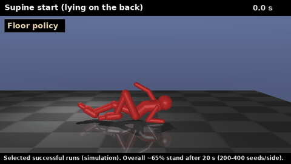

# standai

A 2D MuJoCo ragdoll biped learning to stand up and hold it, from an arbitrary starting posture,
via PPO (Stable-Baselines3). Split out of [`fightai`](../fightai) — the combat self-play league
this body was originally built for — once the standing problem turned out to need its own
rigorous track rather than being a side quest.

전체 배경과 상세 히스토리(한국어)는 [`docs/stand_only_track.md`](docs/stand_only_track.md),
축약된 영문 요약은 [`docs/TECHNICAL_SUMMARY.md`](docs/TECHNICAL_SUMMARY.md) 참고.

> ## Result: a ragdoll lying on the floor stands up and is still standing 20 s later in **about 62%** of starts
>
> Rule-based controller with three learned policies (floor policy -> hand-over policy (prone side) -> stand policy): `ppo_floor_v12` / `ppo_floor_prone8` / `checkpoints/best_handover_prone.zip` / `checkpoints/best_stand_v55b.zip`, hand-over region level 0.7:
> **62.5%** standing after 20 s on seeds never used for any decision (supine start 49%, prone start 76%, 200 seeds each; the same seeds without the hand-over policy: 54.8%, with the previous stand policy and no hand-over policy: 47.8%). At the start of the project this was **0/160**.
> Caveats: simulation only; the 50:50 supine/prone weighting is an assumption (the environment's own 80:20 split is an artefact of its collapse generator, docs 3.20); 200 seeds per side (+-3.5 points). The supine side (49%) is limited by the floor policy (26% of starts never reach the hand-over region; the rest often arrive leaning back, unrecoverable, docs 3.24). Reproduce: `STANDAI_NO_RECOVERY_GATE=1 .venv/bin/python -I scripts/analysis/funnel.py --ho-prone checkpoints/best_handover_prone.zip --n 200 --seed0 13000` (~8 min).



*Four selected successful runs (two supine, two prone starts) of the whole system: floor policy -> hand-over policy (prone side) -> stand policy. They are picked from seeds that end standing without ever falling on the way (some other starts stand, fall and get up again, or never get up); the overall rate is ~62% (supine ~49%, prone ~76%, 200 seeds per side), so most other starts end differently. Higher quality: [`assets/demo.mp4`](assets/demo.mp4). Regenerate (headless, no display needed): `python scripts/render_demo.py`.*

## Update 2026-10-18

The stand policy is now `checkpoints/best_stand_v54.zip` (`v54` @20.3M): the controller (floor policy -> stand policy hand-over) stands after 20 s in **41%** of starts at the strict hand-over region (**50%** at level 0.7, see the result above; 50:50 supine/prone average, 200 seeds per side; the previous stand policy `v37`: 29%).
The gain came from lowering the PPO learning rate (5e-5) on a stand run whose `approx_kl` was 0.09: the earlier runs were not improving, they were jumping by +-50 hand-off catches between checkpoints. The benchmark now prints each start side and a 50:50 average,
because the environment's 80:20 supine/prone split of lying starts turned out to be an artefact of its collapse generator (docs/experiments_2026-10-11.md 3.20). With the controller's hand-over region loosened to level 0.7 the 50:50 average rises further to ~50% (docs 3.21). In progress: the supine floor policy retrained from scratch (`ppo_floor_s4b`).
The status below (2026-10-17) is the previous state.

## Current status (2026-10-17)

The problem is split into **three policies** (the single stand policy never learned to get off the floor: 0/160 genuine uprights from starts below 0.6 m). The sign of the initial torso pitch (observable) picks the floor
policy; both hand over to the stand policy once the body is in the *stand-ready region* (foot down, torso >= 1.08 m, knees > -20 deg, |pitch| < 20 deg, |vz| < 1 m/s, |pitch rate| < 100 deg/s).
A rule-based controller that does exactly this (`scripts/controller.py`) is the best end-to-end system so far. **`scripts/analysis/benchmark.py` measures the whole system in one table (~4 min).**

| Policy | Job | State (deterministic, fixed seeds, `benchmark.py`) |
|---|---|---|
| **Supine floor policy** (`train_floor.py`, `FloorEnv`, `v12`) | lying on the back (~80% of lying starts) -> stand-ready region | reaches the region from 56% of its starts; the stand policy then holds 3 s in 49% of those (28% of starts) |
| **Prone floor policy** (`--prone-frac 1.0`, `prone3 -> prone4 -> prone8`) | lying face down (~20%; inferred from the pitch sign, unverified) -> region | 0% with a plain restart; 63% reach with a staged target (loose -> strict, `--level-start 0.0`) from a pre-trained network; stand policy holds 35% of those (22% of starts); plateau since ~77M steps |
| **Stand policy** (`train_locomotion.py`, `v37`@96M) | hold the stand from what the floor policies hand over | upright-start gate 51/100; **holds 127/300 (42%) of held-out hand-off states**; crouched starts 90 / 68 / 43 / 23% by knee bend (>= -10 / -25..-10 / -40..-25 / < -40 deg). Six from-scratch runs and four fine-tuning variants on a hand-off pool did not move the 42% |

**End to end (rule-based controller, natural start mix, 20 s): 24% of starts end standing** (18-20% without falling back to the floor policy when the stand policy falls; floor policies alone 4%).

**Newest result (in progress): the stand policy's knee-angle clamp was a crutch.** Stand training clamps the knee at -50 -> -80 deg in upright-start episodes (the model's real range is -140 deg); evaluation and hand-over never have it, and policies
trained with it lean on it (the trainer's `fall_rate` looked healthy while the fixed-seed gate was 0). Removing it (`--no-knee-floor`, run `v48`: x1.5 body, v21-era reward, from scratch) is the first from-scratch run to leave gate 0
(alarm gate 0.37-0.47 by 10M steps), but at 16.8M steps it is still below `v37` in the benchmark (hand-off catch 88/300 vs 127/300, upright-start gate 41 vs 51, controller 20% vs 24%); it keeps training and is benchmarked every ~10M steps.

What did not move the stand policy's 42% catch: fine-tuning `v37` on a pool of 8,000 hand-off states (40% of starts, failure-weighted replay, exploration kept: it memorises the pool, held-out catch 127 -> 127); a loose pool (`v38`);
six from-scratch runs with the clamp; hand-over timing and looser hand-over regions (reach rises 63 -> 79% but the number held stays ~22% of starts); a centre-of-mass condition in the floor policy. The states the stand policy loses have the
centre of mass ~10 cm ahead of the front foot (they need a step).

A measurement trap: the trainer's `fall_rate` is optimistic because of that clamp; judge with the fixed-seed gate, the benchmark and continuous indicators (torso height after 3 s, share of time above 0.7 m). Small alarm gates (30 seeds) are a direction check only.

Open problems, in order of importance: (1) does `v48` beat `v37`'s catch of hand-off states (42%) with more steps; (2) the crouched-start gap (the stand policy's weak spot: 23-43% below -25 deg of knee bend); (3) retrain the supine floor policy with the prone recipe (`--supine-frac 1.0`); (4) a learned hand-over selector (only if labelled snapshots give a classifier AUC >= 0.8); (5) every result is a single training run.

What the investigation found (details, numbers and failures: [`docs/experiments_2026-10-11.md`](docs/experiments_2026-10-11.md)):

1. **The low harsh score is "cannot get up", not a measurement artifact.** Of collapsed starts that
   begin below the fall height, ~0-3% end up standing within the environment's 5 s window.
2. **The body can get up, but with little torque margin.** A closed-loop MPC oracle (exact simulator,
   diagnostic only) stands from 2/6 lying starts at the original actuator gears, and 5/6 at x1.5.
   An open-loop CEM search never did (it finds headstands and mid-air leaps). Hence the body spec
   changed to **x1.5 maximum limb torque** (`BODY_GEAR_SCALE` in `locomotion_env.py`; set
   `STANDAI_BODY_GEAR=1` to reproduce older numbers). Link masses were not scaled, so this is
   slightly optimistic for real hardware. The floor policy confirms the torque point: 65% of its
   deterministic actions sit at the +-1 limit.
3. **Reward shaping, failed-start replay, correlated noise, bursts and a frontier-ladder reset archive
   did not make the single policy get up from the floor** (policy-alone head > 0.5 m stayed at 4-8% of
   floor starts, below random bang-bang patterns at 77%). A fresh network trained on floor starts only
   did: 72% at 0.6M steps without bursts, whereas env-level bursts *hurt* it (20% at 1.3M steps).
   Getting to the *stand-ready* region (not just head height) needed the right target: staged targets
   (loose -> strict) worked on top of a network that already knew how to get high, and failed from scratch.
4. Measurement lessons: training-log metrics disagree with the deterministic gate; torso-height-only
   objectives get exploited (inverted/airborne poses); 100-seed gates are too noisy for single
   comparisons; **a "success" has to be checked by what happens next** -- the floor policy's first
   success definition (head >= 0.9 m once) turned out to be a pop-up the same policy could not hold,
   and the check that "proved" it continued the *wrong* policy (the stand policy takes over after
   hand-off). Both errors are written up in the experiments doc.

Earlier history: for most of this track the real gate sat at a flat **0%** while training-log metrics
kept looking better; two silent measurement bugs (a stale module-level override, and a viewer that
never passed `stand_only=True`) and a restart from scratch (`v21`) ended that. The physical capability
of *holding* a stand was never in question (a `qfrc_bias` measurement shows it costs 1-5% of each
joint's maximum output).

Limits to keep in mind: 2D sagittal-plane model, limb torque raised to x1.5 without scaling link
masses, and ~100M steps of training (get-up papers use ~5B). Much of the code and analysis was written
in a pair-programming loop with Claude (an AI assistant); experiment design decisions and review were
the repository owner's.

## Setup

```bash
python -m venv .venv
.venv/bin/pip install mujoco gymnasium stable-baselines3 tensorboard
```

`watch_locomotion.py` needs a machine with an OpenGL context. Training itself runs headless.

## Project layout

```
models/fighter2d.xml          Generated MJCF model (build_model.py builds it — copied from fightai)
scripts/build_model.py        Model generator (copied from fightai, shared body definition)
scripts/env.py                Fighter2DEnv base class (copied from fightai; LocomotionEnv subclasses it)
scripts/locomotion_env.py     LocomotionEnv: the stand/recover environment (stand_only mode)
scripts/train_locomotion.py   PPO training entrypoint, performance-gated curriculum
scripts/watch_locomotion.py   Interactive MuJoCo viewer for a trained checkpoint
scripts/floor_env.py          FloorEnv: lying starts only; targets: loose hand-off / stand-ready region (standready), staged level 0..1,
                              prone-only starts (prone_frac), optional COM condition (com_max), 5 s KO rule off (down_timeout)
scripts/train_floor.py        PPO entrypoint for the floor get-up policies (--prone-frac, --level-start, --no-down-timeout, --max-steps, ...)
scripts/floor_progress_notify.py  KakaoTalk pings: policy-alone eval, split by start side, stand policy taking over for 3 s
scripts/watch_floor.py        Viewer for the floor policy (--stand <ckpt> hands over, --only-success --skip-replay shows only the catch,
                              --lying-only --prone-frac 1.0 prone starts only)
scripts/make_handoff_pool.py / make_strict_pool.py  collect hand-off states for training the stand policy (loose / strict region)
scripts/controller.py         GetUpController: rule-based combination of the supine / prone floor policies and the stand policy (scripts/analysis/controller_eval.py)
scripts/stand_progress_notify.py  Periodic KakaoTalk progress pings with a real fixed-seed gate
scripts/kakao_notify.py       Shared KakaoTalk notify helper (copied from fightai)
checkpoints/                  Trained models, autosaves, logs (gitignored)
docs/                         Technical documentation (Korean full history + English summary)
docs/experiments_2026-10-11.md  Why harsh won't learn: measurements, negative results, MPC oracle, gear findings
scripts/analysis/             Diagnostics behind that doc (gates, MPC oracle, reward-by-height, gear sweep)
```

`build_model.py`/`env.py` are copies of fightai's versions, not a shared dependency — if the body
definition changes, both repos need the change applied by hand. See fightai's README for why this
split was done by copy rather than a shared submodule.

## Running things

**Training (learn to stand from any posture):**
```bash
cd scripts
../.venv/bin/python train_locomotion.py --n-envs 8 --timesteps 80000000 --stand-only --out my_stand
```

**Resuming from a checkpoint:**
```bash
../.venv/bin/python train_locomotion.py --n-envs 8 --timesteps 80000000 --stand-only \
  --out my_stand --init-from ../checkpoints/autosave/my_stand_..._steps.zip
```

**Watching a trained policy:**
```bash
DISPLAY=:1 ../.venv/bin/python watch_locomotion.py ../checkpoints/autosave/my_stand_..._steps.zip
```

**Training the prone floor policy (staged target, warm start, strict region, lying face-down only):**
```bash
cd scripts
../.venv/bin/python train_floor.py --n-envs 8 --timesteps 150000000 --out ppo_floor_prone8 --floor-burst-rate 0.0 \
  --standready --crouch-frac 0.0 --max-steps 450 --prone-frac 1.0 --no-down-timeout --speed-pen 0.0 --air-pen 0.0 \
  --learning-rate 5e-5 --init-from ../checkpoints/best_prone8.zip
# staged target: add --level-start 0.0 --level-gate 0.35 --level-step 0.05 (needs a network that can already get high; see docs)
```

**Progress notifications (KakaoTalk, every 30 min, includes a real fixed-seed gate measurement):**
```bash
nohup ../.venv/bin/python stand_progress_notify.py \
  --log ../checkpoints/locomotion_train_my_stand.log \
  --ckpt-glob '../checkpoints/autosave/my_stand_*_steps.zip' \
  --total-timesteps 80000000 --interval-minutes 30 &
```

## Methodology note

The single most important lesson carried over from fightai: SB3's own training-log metrics
(`fall_rate`, `ep_len_mean`, etc.) are measured under stochastic rollout over long episodes and can
look good or bad independently of what actually matters — whether the policy, acting
deterministically from a fresh reset, stays upright for a full 3 seconds. Every progress check in
this repo re-measures that directly (`stand_progress_notify.py`'s `gate_survival_rate*` functions)
rather than trusting the log.

## Roadmap

Standing (from any posture, held reliably) → walking (reintroducing velocity tracking) → transplant
the resulting policy back into fightai's combat action/observation space via
`transplant_locomotion.py` (still in fightai) — each stage gated on the previous one actually
working.

## License

MIT, see [`LICENSE`](LICENSE). `build_model.py`, `env.py`, `view.py` and `kakao_notify.py` are copies of files from the author's [`fightai`](https://github.com/SungyupKim/fightai) project.
